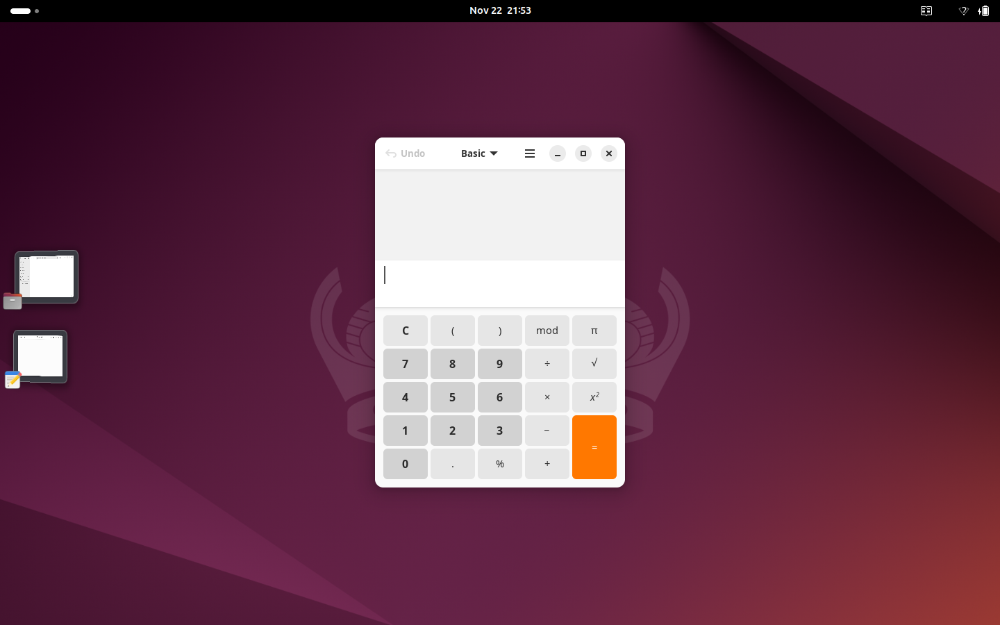

# Stage Shelf

为 Ubuntu 24.04 / GNOME Shell 46 实现的台前调度。点击桌面左侧的窗口预览即可切换应用组，同组窗口保留各自的位置和大小。



## 安装

下载 [GitHub Release](https://github.com/Palind-Rome/stage-shelf/releases/latest) 中的扩展包，在下载目录运行：

```sh
gnome-extensions install stage-shelf@palind-rome.github.io.shell-extension.zip
```

注销并重新登录 Ubuntu，然后运行：

```sh
gnome-extensions enable stage-shelf@palind-rome.github.io
```

也可以从源码打包。运行 `gnome-extensions pack extension` 会在当前目录生成相同格式的安装包。

## 使用

| 操作 | 效果 |
| --- | --- |
| 单击左侧预览 | 切换到该组，恢复同组窗口 |
| Shift + 单击预览 | 将这组窗口加入当前组 |
| 顶栏 Stage Shelf 菜单 → Separate focused application | 将当前应用的窗口拆为独立一组 |
| 在预览上滚动 | 浏览超出屏幕高度的其他组 |
| 前台窗口挡住预览时，将指针移至工作区左沿中段 | 临时显示预览。如果 Ubuntu Dock 固定在左侧，请移到 Dock 紧邻桌面的一侧 |
| 关闭顶栏菜单内的开关 | 还原扩展收起的窗口，回到普通桌面 |

默认按应用分组。预览取自窗口收起时的画面，保存在内存中。全屏和 GNOME 概览期间隐藏侧栏。扩展管理主显示器当前工作区的普通窗口，切换工作区会恢复上一工作区的窗口并重新分组。手动最小化的窗口保持收起。对话框随所属应用处理。

交互与视觉参考 [Apple 台前调度使用指南](https://support.apple.com/guide/mac-help/mchl534ba392/mac)。此项目独立实现，使用 GNOME Shell、Mutter 和系统应用图标。支持的 Shell 主版本为 46。

## 移除

```sh
gnome-extensions disable stage-shelf@palind-rome.github.io
gnome-extensions uninstall stage-shelf@palind-rome.github.io
```
