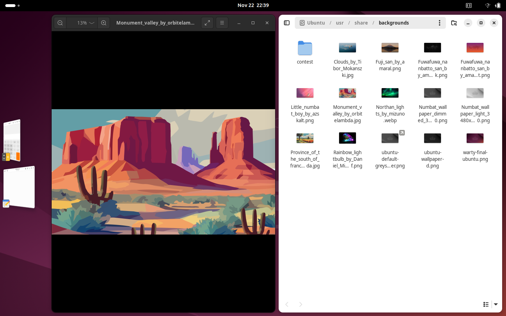
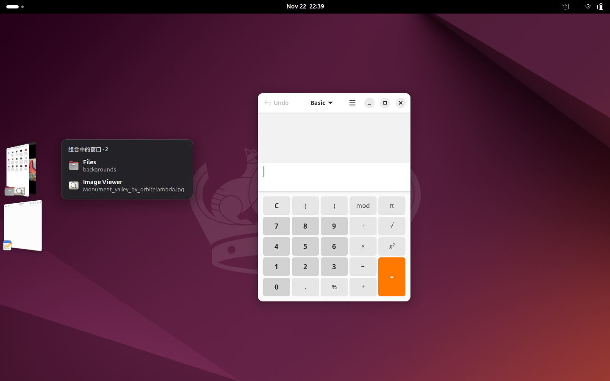

# Stage Shelf

Ubuntu 24.04 / GNOME Shell 46 的台前调度扩展。屏幕左侧显示最近窗口的透视缩略图，前台可以是一个窗口，也可以是一组应用。


## 同时使用两个应用

1. 打开两个应用。将左侧的一个预览**拖到当前窗口所在的桌面区域**，或在顶栏菜单选择 **添加窗口到当前组合**。也可以 Shift + 单击预览加入整组。
2. 两个窗口可以自由移动、调整大小或重叠。要同时看清它们，在顶栏菜单选择 **并排显示两个窗口**。此操作会调整窗口尺寸，退出后保留你选择的排列。
3. 普通单击其他预览会切换整组。点回组合的叠放预览，两扇窗口会一起恢复。



## 查看组合里有哪些窗口

同一组显示错开的窗口预览，下方分别显示应用图标。把鼠标停在组合上，即可按行查看**每扇窗口的应用名和窗口标题**。同一应用的不同文档也分别列出。点击某行会恢复整组，并将所选窗口置于最前。窗口多时可以滚动清单。



## 其他操作

| 操作 | 效果 |
| --- | --- |
| 在顶栏菜单选择「将当前窗口移出组合」 | 将焦点窗口单独收进预览列，组内其他窗口留在前台。此项仅在组内有多个可见窗口时出现 |
| 在顶栏菜单关闭「显示最近窗口」 | 将预览列设为边缘唤出 |
| 将指针移至工作区左沿中段 | 窗口挡住预览时临时唤出。如果 Ubuntu Dock 固定在左侧，使用紧贴 Dock 的工作区一侧 |
| 在预览上滚动 | 浏览超出屏幕高度的组 |
| 选择「退出台前调度」 | 恢复扩展收起的窗口，并关闭扩展及其顶栏图标。可在 GNOME「扩展」中重新开启 |

默认按应用归组。扩展管理主显示器当前工作区的普通窗口。首次展示的单个普通窗口在空间充足时居中，之后可以自行移动。GNOME 最大化继续填满工作区；与预览列重叠时，预览列自动隐藏。全屏与活动概览期间隐藏预览。预览是保存在内存里的窗口快照。切换工作区会还原上一工作区的窗口并重新分组。

## 安装或更新

下载 [扩展安装包](https://github.com/Palind-Rome/stage-shelf/raw/refs/heads/main/dist/stage-shelf%40palind-rome.github.io.shell-extension.zip)，在下载目录运行：

```sh
gnome-extensions install --force stage-shelf@palind-rome.github.io.shell-extension.zip
```

保存工作、注销并重新登录，然后在 GNOME「扩展」启用 Stage Shelf，或运行：

```sh
gnome-extensions enable stage-shelf@palind-rome.github.io
```

从源码打包可运行 `gnome-extensions pack extension`。如需移除：

```sh
gnome-extensions disable stage-shelf@palind-rome.github.io
gnome-extensions uninstall stage-shelf@palind-rome.github.io
```

## 与 macOS 的对应关系

Apple 的台前调度允许单击切组、拖动组合、同组窗口自由重叠，也支持选择一次显示同一应用的全部窗口或单个窗口。Stage Shelf 默认采用同一应用一起显示的方式，另提供 GNOME 菜单用于编组和并排。[Apple 台前调度指南](https://support.apple.com/zh-cn/guide/mac-help/mchl534ba392/mac)

透视角度、叠放与图标位置参考 Apple 的 Ventura 实机图。Mac 上已有手动放大窗口覆盖预览、边缘唤出预览的演示。GNOME 最大化沿用 Mutter 的工作区尺寸。Ventura 的同一应用窗口堆可以点击应用图标展开；跨应用组合在堆叠下方显示各应用图标。这里另加了悬停标题清单。[MacStories 正式版实测](https://www.macstories.net/stories/macos-ventura-the-macstories-review/2/)

具体 macOS 版本执行原生「填充」时的窗口几何仍需该版本实机验证。[Apple 实机图](https://www.apple.com/newsroom/images/product/os/macos/standard/Apple-WWDC22-macOS-Ventura-Stage-Manager-220606_big.jpg.large.jpg) · [MacStories 操作演示](https://www.macstories.net/stories/macos-ventura-the-macstories-preview/)
